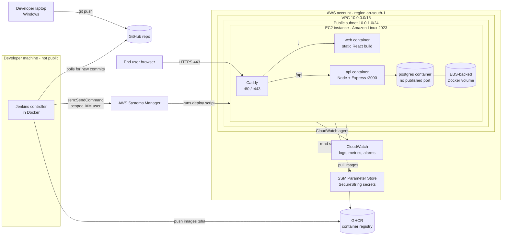
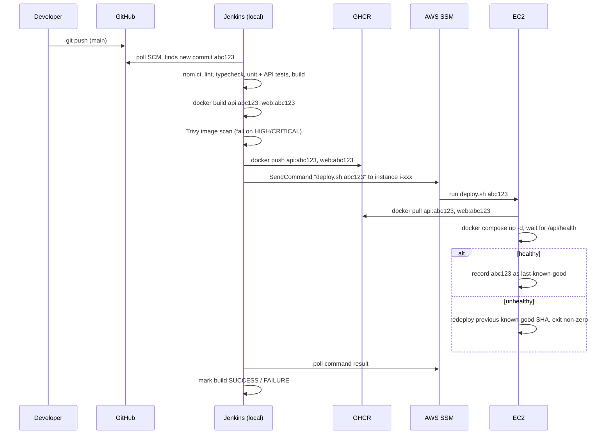

# SplitSmart — Architecture

> Status legend used across all docs:
> ✅ Implemented & verified · 🟡 Implemented, not yet verified · 📄 Documented, not implemented · ⛔ Blocked (needs credentials / manual setup)
>
> **Current status of everything on this page: 📄 Documented, not implemented (Phase 0).**

## 1. The one-paragraph version

SplitSmart is a small web app for splitting shared expenses (think Splitwise-lite).
A **React** single-page app talks to an **Express** REST API, which stores data in **PostgreSQL**.
All three run as **Docker containers** on one **AWS EC2** virtual machine, behind a **Caddy**
reverse proxy that terminates **HTTPS**. The EC2 machine and its network are created by **Terraform**.
**Jenkins** tests every commit, builds images tagged with the Git commit SHA, pushes them to
**GitHub Container Registry**, and deploys them by asking **AWS Systems Manager (SSM)** to run a
deploy script on the instance. **CloudWatch** collects logs and metrics and raises alarms.

## 2. Big picture

## 3. Request path (what happens when a user opens the site)

1. Browser resolves the hostname (e.g. `13-201-x-x.sslip.io` or a real domain) to the EC2 **Elastic IP**.
2. The connection reaches the **security group**, which allows only TCP 80 and 443 inbound.
3. **Caddy** terminates TLS using a free Let's Encrypt certificate it obtained automatically.
4. Caddy routes `/api/*` to the `api` container and everything else to the `web` container,
   over a private Docker network. Because both are the **same origin**, no CORS is needed.
5. The API checks the user's auth cookie, validates input, checks group membership, and queries
   PostgreSQL on the internal Docker network. **Postgres has no port published to the host**, so it's
   unreachable from the internet even if the security group was misconfigured.

## 4. Deployment path (what happens when code is pushed)

Key ideas:
- **Immutable images**: each image tag is a commit SHA, never `latest` in production, so a deploy is
  always reproducible and a rollback is "deploy the previous SHA".
- **Infrastructure and application are separate workflows**: Terraform runs manually with a reviewed
  plan; Jenkins only deploys application images. A bad app commit cannot delete the server.
- **No inbound SSH**: SSM Run Command works through an outbound HTTPS connection from the instance's
  SSM agent, so port 22 stays closed.

## 5. Components and why they exist

| Layer | Choice | Responsibility |
|---|---|---|
| Frontend | React + Vite + TypeScript + Tailwind | UI; compiled to static files served by a small web container |
| Backend | Node.js + Express + TypeScript | REST API, auth, validation, authorization, split math |
| Database | PostgreSQL 16 | Durable relational data with transactions and constraints |
| Migrations | node-pg-migrate | Versioned, repeatable schema changes |
| Containers | Docker + Docker Compose | Same runtime on laptop and EC2 |
| Reverse proxy | Caddy | HTTPS (auto Let's Encrypt), routing `/` vs `/api` |
| Registry | GHCR | Stores versioned images |
| CI/CD | Jenkins (Declarative Pipeline) | Test → build → scan → publish → deploy |
| IaC | Terraform | VPC, subnet, security group, IAM role, EC2, Elastic IP, alarms |
| Remote ops | AWS Systems Manager | Deploy commands & shell access without SSH |
| Secrets | SSM Parameter Store (SecureString) | DB password, JWT secret, GHCR read token |
| Observability | CloudWatch Logs + Metrics + Alarms | Container logs, CPU/disk/memory, status-check alarms |

## 6. Network design

| Resource | Setting | Reason |
|---|---|---|
| VPC | `10.0.0.0/16`, dedicated (not the default VPC) | Learn and control every networking piece; costs nothing |
| Public subnet | `10.0.1.0/24`, one AZ | Instance needs a public IP for users and for Let's Encrypt |
| Internet Gateway + route `0.0.0.0/0` | attached to VPC | Lets the public subnet reach / be reached from the internet |
| NAT Gateway | **none** | ~USD 30+/month; not needed because the only instance is in the public subnet |
| Security group inbound | 80, 443 from `0.0.0.0/0` | Web traffic only. 80 is needed for the HTTP→HTTPS redirect and ACME challenge |
| Security group inbound | **no 22, no 5432** | Admin via SSM; DB is internal-only |
| Security group outbound | all | Pull images, reach SSM/CloudWatch endpoints, OS updates |

## 7. Known limitations (it's a portfolio architecture, not production HA)

- **Single point of failure**: one EC2 instance in one Availability Zone. If it dies, the site is down
  until it's recreated. Data survives on the EBS volume and in backups, but not automatically elsewhere.
- **Database on the same host**: CPU/memory contention, and backups are our responsibility.
- **Jenkins on a laptop**: it's offline when the laptop is off, and GitHub webhooks can't reach it,
  so we poll instead. Deploys happen only while the laptop is running.
- **Vertical scaling only**: to handle more load you'd resize the instance (downtime).

## 8. How this would evolve for production

1. **Database** → Amazon RDS for PostgreSQL (Multi-AZ): managed backups, point-in-time recovery, failover.
2. **Compute** → 2+ instances in an Auto Scaling Group across AZs, or ECS on Fargate (no servers to patch).
3. **Traffic** → Application Load Balancer + AWS Certificate Manager for TLS; instances move to private subnets
   (then you *do* need NAT or VPC endpoints).
4. **CI/CD** → Jenkins on a dedicated always-on host with ephemeral agents, or GitHub Actions with OIDC
   federation to AWS (no long-lived keys at all).
5. **State** → Terraform remote state in S3 with locking.
6. **Edge** → Route 53 DNS, CloudFront CDN for static assets, AWS WAF.
7. **Secrets** → AWS Secrets Manager with automatic rotation.
